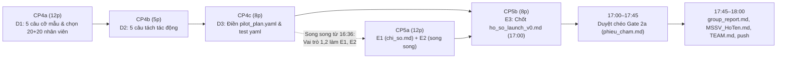

# Kế hoạch tiến trình CP4 (Nhiệm vụ D) & CP5 (Nhiệm vụ E + Duyệt chéo)

> Tài liệu điều phối nội bộ cho giai đoạn **16:08 → 18:00** (CP4 & CP5), bám sát [CHECKPOINTS.md](CHECKPOINTS.md), [RUBRIC.md](RUBRIC.md), [SUBMISSION.md](SUBMISSION.md) và hướng dẫn từ [slide-d1-ba-cach-chia.html](slide-d1-ba-cach-chia.html).

## 1. Phân công tổng quan (4 vai trò)

| Vai trò | Phụ trách chính ở CP4 (16:08–16:36) | Phụ trách chính ở CP5 (16:36–18:00) |
| --- | --- | --- |
| **Vai trò 1: Người viết code** (`ngdinhtruong28`) | Chạy & đối chiếu số D1 trong `src/lab13.py` + tính `power` ở mức 5 điểm (0,64) và tỉ lệ `mo_lai_trong_7_ngay` hiện tại (4,25% / 3,97%) | Tính 3 chỉ số E1 trên 1.200 yêu cầu; hỗ trợ thiết kế 6+ event có `trace_id` trong `report/team/chi_so.md` |
| **Vai trò 2: Người kiểm số** (Nguyễn Tuấn Dũng) | Điền phần chú thích D1, D2 vào đầu `report/team/pilot_plan.yaml`; kiểm tra tay câu e (`m ≥ 299`, `DE = 6,96`) | Điền bảng E2 (Rủi ro kinh tế) trong `report/team/chi_so.md` lấy số từ `bang_chi_phi.md`; chạy kiểm tra `yaml.safe_load` & rà số `simulated` |
| **Vai trò 3: Người gắn nhãn 1** (Nguyễn Lê Đăng Khoa) | Soạn 5 câu D2 + 3 luật dừng 4 vế (`NẾU – TRONG – THÌ – KHÔNG THÌ`) và các trường `identifiability`, `rollback`, `simulated_inputs` trong `pilot_plan.yaml` | Kiểm tra chéo bảng E1 ↔ danh sách event trong `chi_so.md`; dẫn dắt phần **hội đồng chấm nhóm n+1** vào `report/team/phieu_cham.md` |
| **Vai trò 4: Người gắn nhãn 2 kiêm giữ hồ sơ** (Vương Toàn Minh Hiếu) | Rà soát điều kiện "Xong khi" của `pilot_plan.yaml` (không còn `?`, đủ lưu ý từ `slide-d1-ba-cach-chia.html`) | Hoàn thiện **bảy mục + đề xuất** trong `report/team/ho_so_launch_v0.md` trước **17:00**; điều phối `group_report.md`, `TEAM.md` & checklist nộp bài |

---

## 2. Sơ đồ tiến trình & Luồng song song (16:08 → 18:00)

---

## 3. Chi tiết công việc từng Checkpoint

### Checkpoint 4 · Nhiệm vụ D: `report/team/pilot_plan.yaml` (16:08 → 16:36 · 25 + 3 phút)

**Mục tiêu (15đ Rubric C4 + 10đ Hội đồng C8):** Chọn đúng cách chia tách được tác động, đủ cỡ mẫu (hoặc ghi rõ đánh đổi), có ≥ 3 luật dừng đủ 4 vế, file đọc được bằng `yaml.safe_load` và không còn dấu `?` ngoài dòng chú thích.

#### Bước 4A (12 phút) — D1: Cỡ mẫu & chọn cách chia
- [ ] **Vai trò 1 (Code):**
  - Chạy `src/.venv/bin/python lab13.py` lấy 5 kết quả D1 (`a: 1.251`, `b: 3.103 / 42 người`, `c: trần 1.000`, `d: trần 300`, `e: 859/nhóm, m ≥ 299, DE = 6,96`).
  - Tính thêm `power` nếu tác động thật chỉ là `+5` điểm ở `n = 859` (`~0,64`) và tỉ lệ `mo_lai_trong_7_ngay` hiện tại (`4,25%` toàn mẫu; `3,97%` trong `noi_dia + hang_nang`).
- [ ] **Vai trò 2 (Kiểm số — song song):**
  - Kiểm tra phép tính tay câu e (`20m / (1 + (m-1)*0.02) ≥ 859 → m ≥ 299`) và ghi toàn bộ 5 câu D1 + phần đánh đổi vào phần chú thích đầu [report/team/pilot_plan.yaml](report/team/pilot_plan.yaml).

#### Bước 4B (5 phút) — D2: 5 câu kiểm tra "tách được tác động"
- [ ] **Vai trò 3:** Điền 5 câu D2 vào phần chú thích của `pilot_plan.yaml`:
  1. Đối chứng chạy cùng thời gian (`20` nhân viên đối chứng cùng tuần, cùng depot).
  2. Ngẫu nhiên bằng code có seed ghi trước, phân tầng theo depot.
  3. Rủi ro gián tiếp (chia sẻ câu trả lời trong depot) & cách giảm (tài khoản riêng, log theo `staff_id`).
  4. Viết trước chỉ số chính, ngưỡng, luật dừng, ngày quyết định.
  5. Đủ `20` cụm mỗi nhóm.

#### Bước 4C (8 phút) — D3: Điền toàn bộ các trường `pilot_plan.yaml`
- [ ] **Vai trò 3 & 4 phối hợp điền đầy đủ (không để sót dấu `?`):**
  - `owner`: 1 vai trò cụ thể (ví dụ `"Giám đốc vận hành LogiX-VN"`).
  - `scope`: Chỉ `noi_dia` (`0,22×`) và `hang_nang` (`0,69×`), loại `quoc_te` (`1,88×`) và `doi_tac` (`0,85×`).
  - `assignment`: `unit: "staff"`, `control_share: 0.5`, `randomized: true`.
  - `rollout`: `[0.10, 0.25, 0.50]` (`4 → 10 → 20` nhân viên). **Lưu ý từ slide coach:** bước `20` người cần **8 ngày** để gom đủ `299` đơn/người (vì 37–38 đơn/người/ngày × 7 ngày chỉ được ~263 đơn).
  - `primary_metric`: cập nhật `mde: 0.06`, `n_per_arm: 859`, `design_effect: 6.96`, `clusters_per_arm: 20`.
  - `identifiability`, `interim_looks`, `rollback`, `decision_date`, `simulated_inputs`.
  - **3 luật dừng theo mẫu `NẾU – TRONG – THÌ – KHÔNG THÌ` (áp dụng các lưu ý từ `slide-d1-ba-cach-chia.html`):**
    1. **Luật an toàn:** Tách rõ lỗi **tắt ngay từ bước 4 người** (mở lại `> 6%`, hoàn trùng `≥ 1` ca, báo đã hoàn khi sổ cái không ghi) với lỗi **chênh `≥ 2` điểm so với đối chứng** (chỉ áp dụng từ **10 người trở lên**, vì ở 4 người có 56/1.000 lần lệch ngẫu nhiên).
    2. **Luật chi phí:** Ngưỡng `> 8.000 đ/việc` chỉ tính **chi phí biến đổi (~3.400 đ máy + giờ người)**, **không cộng 40 triệu tiền thuê cố định** vào ngưỡng dừng lúc mới mở 4 người.
    3. **Luật sử dụng:** Tỉ lệ bỏ qua gợi ý (`sua + bo`) `> 40%` trong 1 tuần.
- [ ] **Cổng kiểm tra CP4 (16:33–16:36):**
  - `cd src && .venv/bin/python -c "import yaml; yaml.safe_load(open('../report/team/pilot_plan.yaml'))"` chạy không lỗi.
  - `grep -v '^ *#' report/team/pilot_plan.yaml | grep -n '?'` không in gì.

---

### Checkpoint 5 · Nhiệm vụ E & Duyệt chéo Gate 2a (16:36 → 18:00)

#### Bước 5A (16:36 → 16:48 · 12 phút) — Làm song song E1 & E2 trong `report/team/chi_so.md`
- [ ] **Vai trò 1 (Code):** Tính 3 chỉ số E1 trên 1.200 yêu cầu (`Chính: 82,83%`, `Dùng: 27,12%`, `An toàn: 4,25%`), viết **1 chỉ số dùng + 1 chỉ số an toàn tự đề xuất**, và lập **≥ 6 event có `trace_id`** (kèm kiểm tra chéo mỗi chỉ số tính từ event nào). Lưu ý: viết *"chỉ số trong đợt chạy thử là 82,83%"*, **không viết** *"trợ lý đã nâng"*.
- [ ] **Vai trò 2 (Kiểm số):** Điền **E2 · Rủi ro kinh tế** (≥ 2 dòng, lấy số trực tiếp từ `bang_chi_phi.md`, có nhãn `simulated` và vai trò phụ trách):
  - Rủi ro 1: Số ca làm lại tăng gấp đôi (`+51,8%`, lên `6.787 đ` `[simulated]`).
  - Rủi ro 2: Phải xem lại 100% kéo dài (`11.743 đ = 0,98×` hoặc `12.415 đ = 1,03×` `[simulated]`).
  - Rủi ro 3: Khối lượng thấp hơn dự kiến (40 triệu cố định: `+1.185 đ/việc` ở 45k, `+2.370 đ/việc` nếu còn nửa `[simulated]`; ở bước 4–10 người thì xem lại hợp đồng cố định chứ không kết luận trợ lý đắt).

#### Bước 5B (16:48 → 17:00 · 12 phút) — Chốt `report/team/ho_so_launch_v0.md`
- [ ] **Vai trò 4 (Giữ hồ sơ — chủ trì) + cả nhóm duyệt:**
  - Cập nhật **Mục 4** (Chỉ số chính, dùng, an toàn), **Mục 6** (Pilot plan: 20+20 nhân viên, MDE +6đ, 8 ngày ở bước 20 người, power 0,64 nếu hiệu ứng thật +5đ), **Mục 7** (Rủi ro kinh tế — trạng thái `Giả lập`).
  - Chốt **Đề xuất cuối:** **`Go có điều kiện`** (khớp bằng chứng, nêu rõ con số bất lợi power 0,64 & rủi ro xem lại 100%, kèm từng điều kiện, **người phụ trách cụ thể** và **ngày kiểm tra**).
  - Kiểm tra `grep -rni production report/team` không ra kết quả nào.

#### Bước 5C (17:00 → 17:45 · 45 phút) — Duyệt chéo Gate 2a
- [ ] **17:00–17:10:** Gửi `ho_so_launch_v0.md` (và các file liên quan) cho nhóm hội đồng; nhận hồ sơ của nhóm `n + 1`.
- [ ] **17:10–17:25 (Vai trò 3 chủ trì + cả nhóm):** Đọc hồ sơ nhóm `n + 1`, chấm theo 3 tiêu chí (mỗi tiêu chí 0 / 5 / 10đ, tổng `/30đ`) vào [report/team/phieu_cham.md](report/team/phieu_cham.md), viết quyết định, lý do có số và 1 câu hỏi phản biện.
- [ ] **17:25–17:45:** Trình bày 1 phút, nghe hội đồng công bố 1 phút, trả lời 1 phút; ghi lại câu trả lời vào `phieu_cham.md`.

#### Bước 5D (17:45 → 18:00 · 15 phút) — Đóng gói & Nộp bài
- [ ] **Cả nhóm:** Điền [report/team/group_report.md](report/team/group_report.md) (≤ 2 trang) và hoàn thiện đóng góp trong [TEAM.md](TEAM.md).
- [ ] **Mỗi thành viên (4 người):** Copy `report/team/MSSV_HoTen.md` thành file riêng (`report/team/<MSSV>_<HoTenKhongDau>.md`), ghi đủ công cụ AI đã dùng và bằng chứng cá nhân.
- [ ] **Vai trò 1 & 2:** Chạy lại `cd src && .venv/bin/python lab13.py` trên máy thứ hai để xác nhận chạy sạch.
- [ ] **Nhóm trưởng:** Merge hết về `main`, push lên GitHub (không commit `.venv/` hay `.env`), và **cả 4 thành viên tự nộp cùng link repo trên LMS** trước 23h59 GMT+7.
